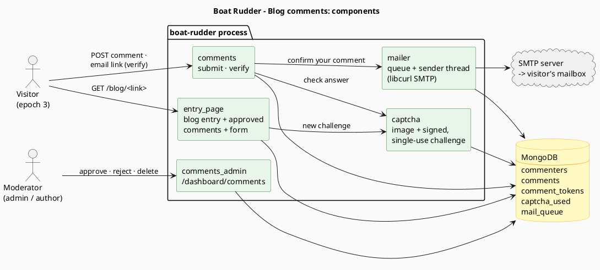
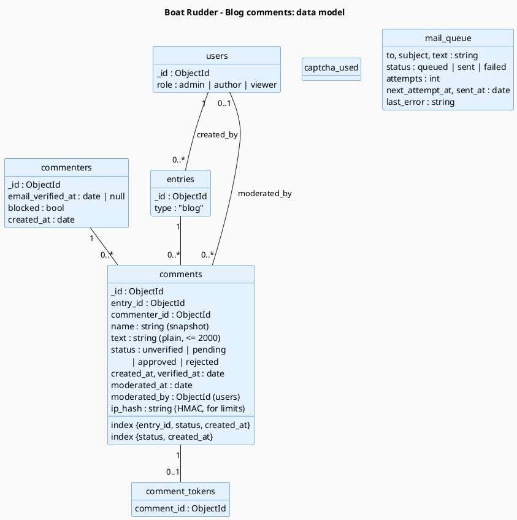
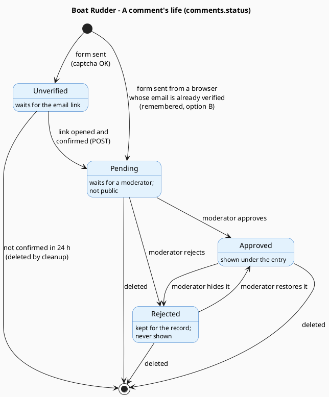
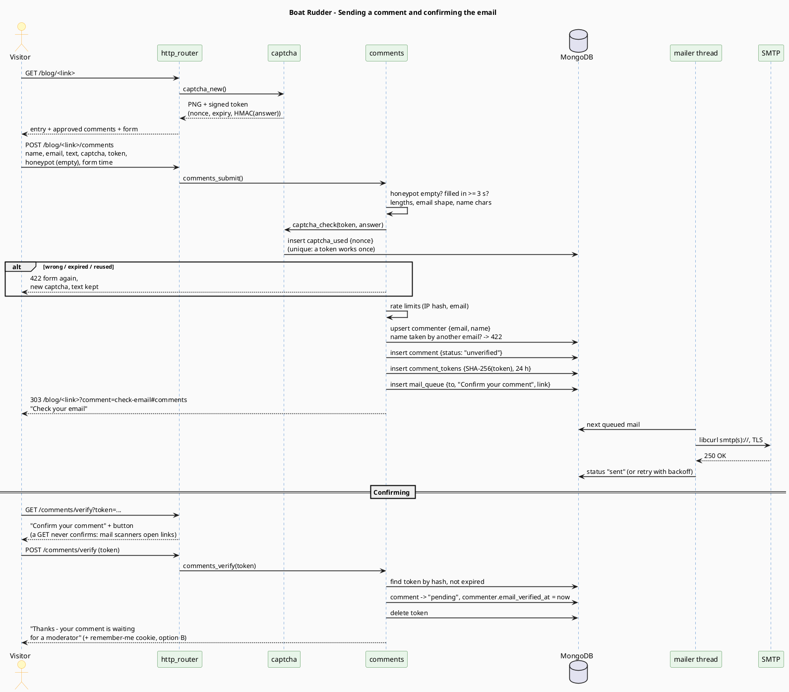
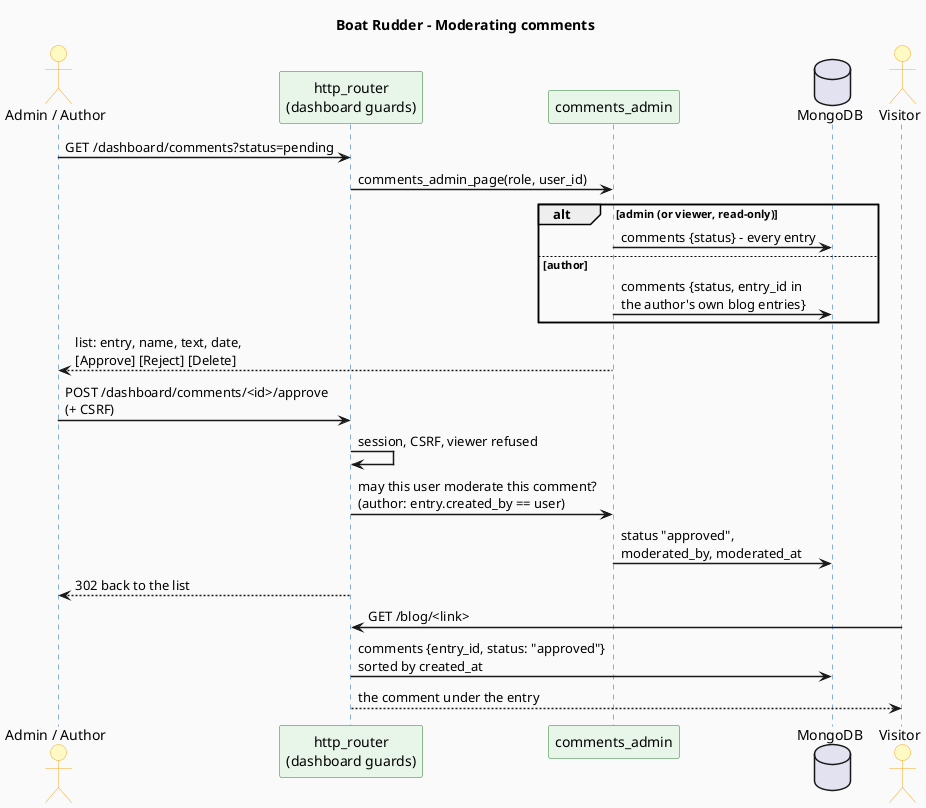

# Plan: blog comments

> **Status**: implemented (2026-10-28), with the proposed answers to §9 - except the first:
> commenters ended up in `users` (role `commenter`), next to a new `moderator` role, so a
> commenter can later join the team; option B (a confirmed browser is remembered); authors moderate their
> own entries; nothing on older epochs yet; no moderator email. Reference:
> [comments.md](../reference/comments.md).
> Diagrams: [comments-components.puml](../diagrams/comments-components.puml),
> [comments-data-model.puml](../diagrams/comments-data-model.puml),
> [comment-states.puml](../diagrams/comment-states.puml),
> [sequence-comment-submit.puml](../diagrams/sequence-comment-submit.puml),
> [sequence-comment-moderation.puml](../diagrams/sequence-comment-moderation.puml).

---

## 1. What is asked

- Visitors can comment on **blog entries** (not pages).
- To comment they give a **name**, an **email** and the **comment**, and pass a **challenge**
  (captcha) that Boat Rudder generates itself - no third-party service.
- **Epoch 3 only** for now.
- The visitor **confirms their email** through a link sent to it.
- A confirmed comment **waits for a moderator**; it is public only once approved.
- **Administrators and authors** moderate.

## 2. Features

### For the visitor (blog entry page, epoch 3)

- Below the article, a **Comments** section: the approved comments, oldest first (name, date,
  text), and the count.
- A **form**: name, email, comment (up to 2000 characters), the challenge image and its answer
  field, and a "Send" button. The email is never shown publicly; the form says so.
- After sending: "**Check your email** - we sent a link to confirm your comment." The form keeps
  nothing filled (the comment is already stored).
- The email holds a link; opening it shows "**Confirm your comment**" with a button (a plain
  link visit never confirms: mail scanners open links on their own). After confirming: "Thanks -
  your comment will appear once a moderator approves it."
- An unconfirmed comment is deleted after **24 hours**.
- A wrong answer, a missing field or a limit reached shows the form again with the message, the
  text kept, and a **new** challenge.
- Other epochs (0-2, WAP): no form and no comments for now (see §9, question 4).

### For moderators (dashboard, epoch 3)

- **Dashboard → Content → Comments** (`/dashboard/comments`), with tabs **Pending** (default),
  **Approved**, **Rejected**: entry title (linked), name, email (only here), date, text, and
  **Approve / Reject / Delete**.
- The dashboard home shows **"Comments pending moderation (N)"** with a link, when N > 0.
- **Administrator**: every comment. **Author**: comments on their own blog entries (see §9,
  question 3). **Viewer** (read-only role): sees what an administrator sees, changes nothing -
  as everywhere else.
- Approved comments can be hidden again (→ Rejected) and rejected ones restored.
- **Block a commenter** (by email): their future comments are refused; optionally delete
  everything they wrote.
- Per entry, in the entry editor: **"Close comments"** - the list stays, the form goes.

### For the site owner (settings)

- **Dashboard → Site → General**: comments **on/off** for the whole site (off by default).
- Mail settings in `configs/settings.conf` (§5). Without them, comments can't be turned on: the
  setting says why.
- A **"Send a test email"** button to check the mail settings.

## 3. Components



> Source: [diagrams/comments-components.puml](../diagrams/comments-components.puml)

| Piece | Where | Does |
|---|---|---|
| `captcha` | `src/utils/captcha.c` (new) | Draws the challenge and checks answers (§4) |
| `mailer` | `src/utils/mailer.c` (new) | Queue in `mail_queue`, one sender thread, SMTP through **libcurl** (already installed; new link dependency) |
| `comments` | `src/modules/comments/` (new) + `src/db/cms_comments.c` | Form, submission, verification, the approved list |
| `comments_admin` | `src/modules/comments_admin/` (new) | Moderation pages |
| `entry_page` | existing | Adds the comments section under blog entries, epoch 3 |
| site secret | `site_settings.secret` (new, generated once with libsodium) | HMAC key for the challenge and for hashing addresses |

## 4. The challenge (own captcha)

Layered, so a bot has to beat all of it:

1. **Image challenge** - 5 characters from an alphabet without look-alikes
   (`ACDEFHJKMNPRTUVWXY34679`), drawn by Boat Rudder itself into a pixel buffer from a built-in
   bitmap font: each glyph scaled, shifted and slanted at random, crossing lines and dot noise,
   encoded as **PNG** (uncompressed deflate - no image library needed) and sent inline
   (`data:image/png`). Case-insensitive answer. A "New image" link reloads the form part.
2. **Signed, stateless token** - the form carries
   `nonce.expiry.HMAC(secret, nonce|expiry|answer)`: the server keeps nothing until an answer
   comes back; expiry 15 minutes.
3. **Single use** - a checked token's nonce goes into `captcha_used` (unique index, TTL): the
   same image can't be answered twice.
4. **Honeypot** - a field hidden from people (CSS) that bots fill in.
5. **Time** - a form sent less than 3 s after it was drawn is refused (the time is inside the
   signed token, so it can't be faked).
6. **Rate limits** - per address: 5 comments per hour; per email: 10 per day; per entry: the
   site-wide DDoS limits still apply. Addresses are stored only as an HMAC (`ip_hash`), never in
   clear.

Accessibility limit: an image challenge excludes blind readers. A text alternative (a simple
question) could be added later; not in this plan.

## 5. Email

- New keys in `configs/settings.conf`:

  ```ini
  mail_smtp_url=smtps://smtp.example.com:465     ; or smtp://...:587 (STARTTLS required)
  mail_smtp_user=comments@example.com
  mail_smtp_password=...
  mail_from=comments@example.com
  mail_from_name=Boat Rudder
  ```

- Sending is **never** done while a visitor waits: the request writes a `mail_queue` document
  and returns; a **sender thread** sends it (timeouts 30 s), retrying with backoff (1, 5, 15,
  60 min; then `failed`). A failed mail shows in the dashboard comment list ("email not
  delivered").
- Plain-text mails, in the site's language of the visitor:
  "Confirm your comment on «entry»: <link> - If you didn't write it, ignore this email."
- The link: `https://<public_url>/comments/verify?token=<64 hex>`; only the token's SHA-256 is
  stored (`comment_tokens`, TTL 24 h), like a password.

## 6. Data



> Source: [diagrams/comments-data-model.puml](../diagrams/comments-data-model.puml)

- **`commenters`** - one per email: the name they use, whether the email was ever confirmed,
  blocked or not. A name is **bound to one email**: someone else can't take "Pablo" once it is
  confirmed by Pablo's email; the names of the site's users are reserved too.
- **`comments`** - the text is **plain text** (no HTML; line breaks kept); the name is copied so
  renaming doesn't rewrite history.
- **`entries.comments_closed`** - new optional flag.
- **`site_settings.comments_enabled`**, **`site_settings.secret`** - new.

Indexes: `commenters.email` (unique), `commenters.name_key` (unique),
`comments {entry_id, status, created_at}`, `comments {status, created_at}`,
`comment_tokens.token_hash` (unique) + TTL, `captcha_used.nonce` (unique) + TTL,
`mail_queue {status, next_attempt_at}`.

## 7. A comment's life



> Source: [diagrams/comment-states.puml](../diagrams/comment-states.puml)



> Source: [diagrams/sequence-comment-submit.puml](../diagrams/sequence-comment-submit.puml)



> Source: [diagrams/sequence-comment-moderation.puml](../diagrams/sequence-comment-moderation.puml)

## 8. Routes

| Method | Route | Who | Does |
|---|---|---|---|
| `POST` | `/blog/<link>/comments` | anyone, epoch 3 | Send a comment (§4 checks) → `303` back with "check your email", or `422` with the form |
| `GET` | `/comments/verify?token=` | anyone | "Confirm your comment" page with a button |
| `POST` | `/comments/verify` | anyone | Confirms: comment → pending |
| `GET` | `/dashboard/comments?status=` | admin, author, viewer | Moderation list |
| `POST` | `/dashboard/comments/<id>/approve` · `/reject` · `/delete` | admin, author (own entries) | Moderate |
| `POST` | `/dashboard/comments/commenter/<id>/block` | admin | Block an email |
| `POST` | `/dashboard/settings/mail/test` | admin | Send a test email |

The public `POST`s have no session, so no CSRF token: the challenge token plays that role
(it is bound to the page that drew it and works once).

## 9. Decisions to confirm

1. **"Users of type comment"**: proposed as a separate **`commenters`** collection (name +
   email, no password, can't sign in), not a new role in `users`. Keeps the dashboard's sign-in
   untouched and gives commenters nothing to break into. *Alternative*: a `commenter` role in
   `users` with a password and sign-in - more to build, more to secure.
2. **Email check, once or every time?**
   - **A** - every comment needs its own email link. Simplest, strongest, more friction.
   - **B (proposed)** - after the first confirmation the browser gets a signed cookie (1 year)
     for that commenter; comments from that browser go straight to *pending*. From another
     browser, or after clearing cookies, the email link again. Moderation still applies.
3. **Authors moderate** only comments on **their own** blog entries (proposed, same rule as
   editing), or every comment?
4. **Older epochs**: show the **approved comments read-only** on epochs 0-2 and WAP (cheap: the
   list is plain text), or nothing at all until commenting is supported there?
5. **Notify moderators** by email when a comment is waiting? (Proposed: not in this plan; the
   dashboard count is enough to start.)

## 10. Deliveries

| # | Delivers | Can be tried |
|---|---|---|
| 1 | Mail settings, `mailer` (queue + thread + libcurl), site secret, "Send a test email" | A test email arrives |
| 2 | `captcha` (font, drawing, PNG, token, single use) with unit tests | The challenge in a test page |
| 3 | Data layer, submit, verify, 24 h cleanup, rate limits | A comment confirmed by email, stored as pending |
| 4 | Entry page: approved comments + form (epoch 3), comments on/off, close per entry | The whole visitor flow |
| 5 | Moderation pages, dashboard count, block commenter | The whole moderator flow |
| 6 | Docs (`comments.md`, routes, data model, configuration, security), CHANGELOG, end-to-end test with a local fake SMTP server | - |

Each delivery builds warning-free, keeps the existing tests green and gets an end-to-end check
on a scratch database.
